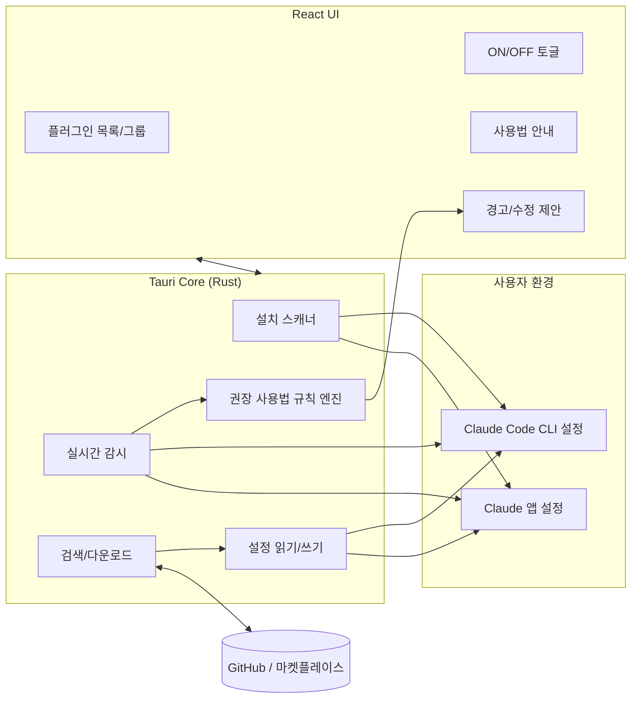

# Plugin Hub

> Claude Code 플러그인을 한곳에서 찾고, 설치하고, 정리하고, 켜고 끄는 데스크톱 앱 (macOS 우선, Windows 확장 예정)


| 항목 | 내용 |
|------|------|
| 스크린샷 / GIF | 🚧 준비 중 (구현 전) |
| 데모 | 🚧 준비 중 |
| 릴리스 | 🚧 준비 중 (첫 릴리스 전) |

> **현재 상태: 기획 단계입니다.** 아직 실행 가능한 코드는 없고, 이 문서의 "핵심 기능"은 모두 목표입니다. 구현 여부는 3장 체크리스트로 구분했습니다.

---

## 1. 왜 만들었나

Claude Code의 플러그인은 GitHub와 여러 마켓플레이스에 계속 늘어나고 있습니다. 쓰다 보면 이런 문제가 생깁니다.

- 어떤 플러그인이 있는지, 무엇에 쓰는 건지 찾고 비교하기 어렵다.
- 설치한 플러그인이 쌓여서 무엇이 켜져 있는지 파악이 안 된다.
- 플러그인마다 권장 사용법이 있는데, 모르고 쓰다가 의도와 다르게 동작한다.
- Claude 앱과 터미널(CLI)에서 각각 무엇이 쓰이는지 구분하기 어렵다.

**대상 사용자:** Claude Code를 쓰면서 플러그인이 많아져 관리가 부담스러운 개발자, 그리고 터미널 설정 파일을 직접 만지는 것이 부담스러운 입문자입니다.

## 2. 해결하려는 것

플러그인의 **검색 → 설치 → 사용법 확인 → 정리 → ON/OFF → 잘못된 사용 감지**를 하나의 GUI에서 처리합니다.

## 3. 핵심 기능과 구현 상태

범례: ✅ 완료 · 🔄 진행중 · ⬜ 예정

- [x] ✅ 프로젝트 기획, 범위 정의, 기술 스택 결정
- [x] ✅ 저장소 구성 (README, 개발 일지, 정리 규칙)
- [ ] ⬜ 플러그인 저장 위치와 ON/OFF 방식 조사 (앱 버전과 CLI 버전 차이 포함)
- [ ] ⬜ 설치된 플러그인 목록 보기
- [ ] ⬜ 앱 버전 / 터미널 버전 구분 표시
- [ ] ⬜ 플러그인 ON/OFF 토글
- [ ] ⬜ 폴더(그룹) 구조로 플러그인 정리
- [ ] ⬜ 플러그인 자동 검색 (GitHub, 마켓플레이스)
- [ ] ⬜ 자동 다운로드 및 설치
- [ ] ⬜ 플러그인별 용도와 사용법 안내
- [ ] ⬜ 권장 사용법과 다른 사용을 실시간 감지하고 경고/수정 제안
- [ ] ⬜ Windows 지원

## 4. 기술 스택과 선택 이유

| 영역 | 선택 | 이유 |
|------|------|------|
| 앱 셸 | **Tauri** | 설치 파일이 가볍고 메모리 사용이 적다. 파일 감시 같은 시스템 작업을 Rust로 안정적으로 처리할 수 있다. macOS와 Windows를 같은 코드로 빌드할 수 있다. |
| UI | **React + TypeScript** | 상태가 많은 목록/토글 UI에 적합하고 생태계가 크다. |
| 시스템 로직 | **Rust** (Tauri 백엔드) | 설정 파일 읽기/쓰기, 파일 감시, 프로세스 감지를 OS별로 분리하기 좋다. |

**검토 후 선택하지 않은 대안**

- **Electron**: 자료가 많고 Node.js를 그대로 쓸 수 있지만, 앱 용량과 메모리 사용량이 크다. 상시 켜 두는 관리 도구에는 부담이라고 판단했다.
- **Swift (macOS 네이티브)**: macOS에서는 가장 자연스럽지만, Windows 확장 때 처음부터 다시 만들어야 해서 제외했다.

> 이 선택은 현재 시점의 판단이며, 1차 조사나 프로토타입 결과에 따라 바뀔 수 있습니다. 바뀌면 이유와 함께 기록합니다.

## 5. 아키텍처 (계획)

아래는 설계 초안입니다. 구현된 구조가 아닙니다.



**데이터 흐름 요약**
1. 스캐너가 앱 버전과 CLI 버전의 플러그인 설정을 읽어 목록을 만든다.
2. 사용자가 UI에서 토글/그룹 변경을 하면 Core가 해당 설정에 반영한다.
3. 감시기가 변경과 사용 상황을 지켜보고, 규칙 엔진이 권장 사용법과 비교해 경고를 만든다.
4. 설치기가 원격 저장소에서 검색/다운로드해 설정에 등록한다.

## 6. 설치 · 실행 방법

아직 실행 가능한 앱이 없어서 **개발 환경 세팅만** 안내합니다. (프로젝트 스캐폴딩 전이라 `npm run tauri dev` 같은 실행 명령은 아직 없습니다.)

필요한 도구 (macOS)

```bash
# Xcode Command Line Tools
xcode-select --install

# Rust
curl --proto '=https' --tlsv1.2 -sSf https://sh.rustup.rs | sh

# Node.js (LTS) - 예: Homebrew
brew install node
```

저장소 받기

```bash
git clone <저장소 URL>
cd plugin-hub
```

스캐폴딩이 끝나면 이 장에 설치/실행 명령을 추가합니다.

## 7. AI와 나의 역할 구분

이 프로젝트는 AI 코딩 도구(Claude Code)와 함께 만듭니다. 역할을 아래처럼 나눕니다.

**내가 하는 것**
- 문제 정의와 범위 결정
- 구조 설계와 기술 선택
- 결과 검증과 버그 원인 판단

**AI에게 맡기는 것**
- 반복 구현
- 초안 작성
- 자료 조사

**AI의 제안을 거절하거나 뒤집은 사례**

> 아직 구현 단계 전이라 기록이 없습니다. 아래 형식으로 쌓아 갑니다. 자세한 날짜별 기록은 [DEVLOG.md](DEVLOG.md)에 있습니다.

| 날짜 | AI의 제안 | 내 판단 | 이유 | 결과 |
|------|-----------|---------|------|------|
| 2026-11-20 | 커밋은 터미널 git, 푸시는 GitHub Desktop 화면에서 하자고 제안 | 거절. 브라우저에 이미 로그인된 상태로 gh 웹 인증을 진행하도록 지시 | GUI 앱은 AI가 조작할 수 없고 설정이 둘로 나뉘어 번거롭다고 판단 | gh 인증 후 한 번에 푸시 완료 |

## 8. 어려웠던 점과 해결 과정

> 아직 기록이 없습니다. 문제를 만날 때마다 아래 형식으로 추가합니다.

### (예정) 제목
- **문제:**
- **원인:**
- **시도 (실패 포함):**
- **결과:**
- **배운 점:**

## 9. 한계와 앞으로의 계획

**현재 한계**
- 구현 전 단계이며, Claude Code 플러그인의 내부 구조(저장 위치, ON/OFF 방식)는 아직 조사하지 못했다.
- 플러그인 구조는 Claude Code 업데이트로 바뀔 수 있어 호환성 유지가 필요하다.
- "권장 사용법"의 기준을 어디서 가져올지(플러그인 문서, 직접 정의 등)는 미정이다.

**로드맵**
1. [ ] 플러그인 저장 구조 조사 (앱 vs CLI)
2. [ ] Tauri + React 스캐폴딩, 읽기 전용 목록 화면
3. [ ] ON/OFF 토글과 그룹 정리 (macOS)
4. [ ] 검색 / 자동 설치
5. [ ] 사용법 안내와 실시간 감지/경고
6. [ ] Windows 대응
7. [ ] 첫 릴리스, 스크린샷/데모 추가
