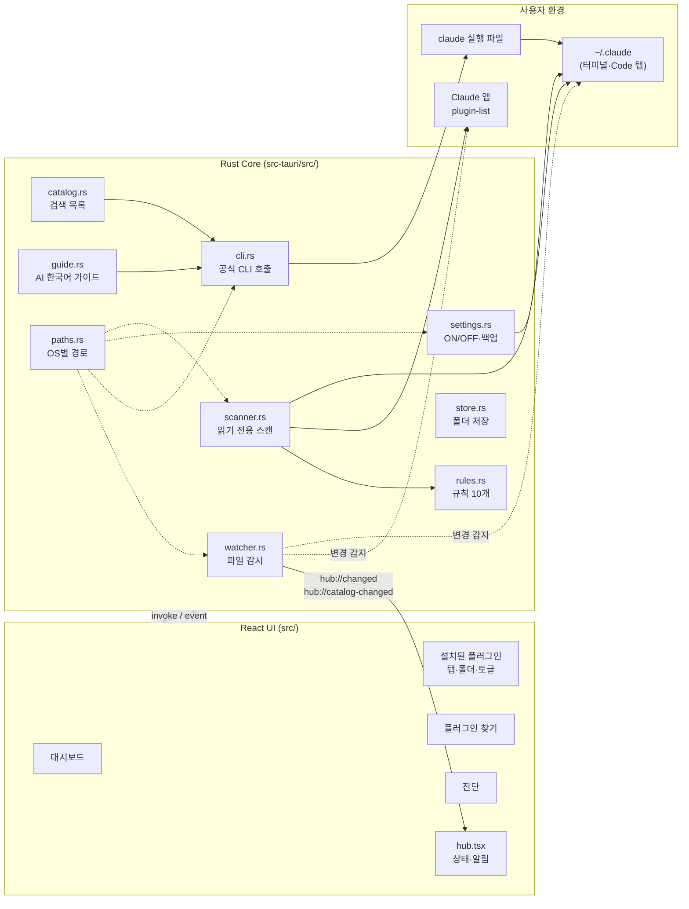

# Plugin Hub

> Claude Code 플러그인을 한곳에서 찾고, 설치하고, 폴더로 정리하고, 켜고 끄는 데스크톱 앱 (macOS 우선, Windows 확장 예정)


| 항목 | 내용 |
|------|------|
| 스크린샷 / GIF | 🚧 준비 중 |
| 데모 | 🚧 준비 중 (지금은 [실행 방법](#6-설치--실행-방법)대로 직접 빌드) |
| 릴리스 | 🚧 준비 중 (코드 서명·공증 전) |

> **현재 상태: macOS용 MVP가 동작합니다.** 이 맥의 실제 Claude 환경에서 스캔, ON/OFF, 검색, 설치 흐름, 실시간 감지를 확인했습니다. Windows 지원과 정식 릴리스는 아직입니다. 구현 여부는 3장 체크리스트에 구분해 두었습니다.

---

## 1. 왜 만들었나

Claude Code 플러그인은 GitHub와 여러 마켓플레이스에서 계속 늘고 있습니다. 공식 디렉터리에만 3,700개가 넘습니다. 쓰다 보면 이런 문제가 생깁니다.

- 어떤 플러그인이 있는지, 무엇에 쓰는 건지 찾고 비교하기 어렵다.
- 설치한 플러그인이 쌓여서 무엇이 켜져 있는지 파악이 안 된다.
- 켜진 플러그인이 많으면 매 세션 컨텍스트 비용이 늘고, 스킬 이름이 겹쳐 엉뚱한 스킬이 불린다.
- Claude 앱과 터미널(CLI)에서 각각 무엇이 쓰이는지 구분하기 어렵다.

**대상 사용자:** 플러그인이 많아져 관리가 부담스러운 Claude Code 사용자, 그리고 `settings.json`을 직접 고치기 부담스러운 입문자입니다.

## 2. 해결하려는 것

플러그인의 **검색 → 설치 → 사용법 확인 → 폴더 정리 → ON/OFF → 잘못된 설정 감지**를 하나의 GUI에서 처리합니다.

## 3. 핵심 기능과 구현 상태

범례: ✅ 완료 · 🔄 일부 완료 · ⬜ 예정

| 상태 | 기능 | 설명 |
|------|------|------|
| ✅ | 플러그인 저장 구조 조사 | 터미널과 앱이 플러그인을 어디에 어떻게 저장하는지 정리 ([4-1](#4-1-조사로-알아낸-플러그인-저장-구조)) |
| ✅ | 설치된 플러그인 목록 | 버전, 출처, 범위, 스킬·명령·에이전트·훅·MCP 구성 표시 |
| ✅ | 앱 / 터미널 구분 | "터미널·Claude Code"와 "Claude 앱(계정 동기화)"을 탭으로 나눔 |
| ✅ | 실시간 ON/OFF | 토글하면 `settings.json`에 바로 반영. 다른 설정 키는 보존하고 수정 전에 백업 |
| ✅ | 적용 범위 (PC 전체 / 폴더별) | 플러그인마다 "PC 전체 기본값"과 "작업 폴더별(팀 공유·나만)" 적용을 따로 설정. 폴더에서는 켬·끔·기본값 따름 중 선택하고, 우선순위(나만 > 팀 공유 > PC 전체)에 따라 실제 적용 결과를 표시. 폴더 선택 창으로 등록하거나 Claude Code로 작업했던 폴더를 추천받아 추가 |
| ✅ | 설치 범위 선택 | 설치 창에서 PC 전체 / 특정 폴더·나만 / 특정 폴더·팀 공유 중 선택 |
| ✅ | 앱 설정 | 새로 설치할 때 기본 범위·폴더, 새 플러그인 자동 확인 주기 |
| ✅ | 폴더 정리 | 폴더 만들기, 이름 바꾸기, 삭제, 플러그인 이동. 폴더 안 플러그인 한 번에 켜고 끄기 |
| ✅ | 플러그인 검색 | 공식 CLI의 카탈로그(3,700여 개)를 이름·용도로 검색하고 마켓플레이스로 거르기 |
| ✅ | 설치 · 삭제 · 업데이트 · 마켓플레이스 추가 | 공식 `claude plugin` CLI를 호출 (확인 창을 거침) |
| ✅ | 명령어 모음 (플러그인별 · 한국어) | '내 플러그인 → 명령어 모음'에서 플러그인을 고르면 그 플러그인의 명령만 보여 줌. "한국어로 보기"를 누르면 내 Claude 계정으로 명령별 한국어 설명·쓰는 법·예시를 만들어 저장(실제 계정에서 commit-commands 17초). 입력 형식, 직접 입력/자동 호출 구분, 복사 버튼 |
| ✅ | 바로 입력 | Claude 앱 플러그인 명령은 "바로 입력"을 누르면 Claude 앱 새 채팅 입력창에 명령이 들어감(보내기는 사용자가). 실제로 넣어 보니 입력창이 명령으로 인식하고 인자 안내까지 표시함. Claude Code 전용 플러그인은 Claude 앱 채팅에 없어서 복사 후 터미널·Code 탭에 붙여 넣도록 안내(Code 탭을 여는 주소가 없음) |
| ✅ | 한국어 설명 | 공식·Anthropic 검수 플러그인 119개는 한국어 요약을 앱에 내장 |
| 🔄 | AI 한국어 가이드 | 버튼을 누르면 내 Claude Code 계정으로 한국어 사용 설명서(용도, 명령어 자세히, 요령, 주의점)를 만들고 저장. **Claude Code CLI 로그인이 필요**하며, 로그인 상태의 실제 생성 결과는 아직 확인하지 못함 |
| ✅ | 용도별 분류 | 18개 분야(개발, 리뷰, 테스트, 배포, 디자인, 데이터, 법무, 재무 등)로 나눠 고르기 |
| ✅ | 분야별 인기 TOP 5 | 고른 분야의 인기 플러그인 5개를 맨 위에 표시 (GitHub 스타 기준) |
| ✅ | 새 플러그인·업데이트 실시간 반영 | 카탈로그 파일이 바뀌면 바로 다시 읽고, 30분마다 마켓플레이스 원본을 확인. 새로 생긴 것은 NEW, 버전이 바뀐 것은 "업데이트"로 7일간 표시하고 알림 |
| ✅ | Claude 앱 변경 즉시 반영 | Claude 앱에서 플러그인을 추가·삭제·켜고 끄면 앱 동기화 파일을 감지해 바로 갱신. 플러그인 찾기에도 "Claude 앱 설치됨"으로 표시 |
| ✅ | 플러그인 찾기: 터미널 / Claude 앱 나눠 보기 | 위쪽 탭으로 전환. 터미널 탭은 `~/.claude`에 바로 설치, Claude 앱 탭은 앱에서 쓸 수 있는 플러그인(공식 디렉터리와 앱에 설치된 것)과 앱 설치 상태를 보여줌. 반대쪽에 설치되어 있으면 "○○에도 있음" 표시 |
| ✅ | Claude 앱 플러그인 자동 설치 (macOS) | Claude 앱 탭에서 "앱에 설치"를 누르면, Plugin Hub가 macOS 손쉬운 사용 기능으로 Claude 앱 디렉터리를 열고 → 이름을 입력하고 → 저장소가 맞는 결과를 열고 → "추가"를 누름. 이후 Claude 앱이 바로 내려받음. 실제 계정에서 pr-review-toolkit(약 11초), commit-commands(약 12초, 계정 플러그인 16→17)를 클릭 없이 설치함. 이미 추가된 플러그인은 디렉터리의 "계정에 추가됨" 구역을 보고 "이미 추가됨"으로 인식(2026-11-21 Claude 앱 화면 변경에 맞춰 수정). 처음 한 번은 macOS 설정에서 Plugin Hub에 "손쉬운 사용" 권한을 허용해야 함(없으면 설정 열기 안내). GitHub 마켓플레이스 플러그인은 아직 Claude 앱의 "마켓플레이스 추가" 창을 채워서 열기까지만 함 |
| ✅ | Claude 앱에서 쓰는 법 도우미 | 앱 플러그인 상세에 3단계 사용법, 기능(스킬) 목록, 고쳐 쓸 수 있는 요청 문장. "새 채팅에 넣기"로 Claude 앱 새 채팅 입력창에 요청을 넣어 줌(보내기는 사용자가). 실제 Claude 앱 입력창에 들어가는 것을 확인함 |
| ✅ | 플러그인 업데이트 자동 설치 | 설정에서 켜면, 터미널·Claude Code 플러그인에 새 버전이 보일 때 확인 없이 하나씩 업데이트하고 알림. 같은 버전은 한 번만 시도해 실패가 반복되지 않음. 켜져 있으면 앱 시작 때도 원본을 한 번 확인. 기본값은 꺼짐 |
| ✅ | 로그인 시 자동 실행 · 백그라운드 유지 (macOS) | 설정에서 켜면 Mac 로그인 때 창 없이 실행(LaunchAgent). 창을 닫아도 앱은 계속 실행되어 감시와 자동 업데이트를 이어 가고, Dock 아이콘을 누르면 다시 열림. 완전 종료는 ⌘Q |
| ✅ | 컨텍스트 비용 표시 | 켜진 플러그인이 매 세션 컨텍스트에 넣는 양(스킬·명령·에이전트 설명)을 플러그인별·합계로 추정해 대시보드 막대그래프와 목록에 표시. 공식 `claude plugin details`의 값과 비교해 맞춘 근사식(실측 비교: 80→70, 210→216 토큰) |
| ✅ | 실제 사용 분석 · 안 쓰는 플러그인 끄기 추천 | 이 Mac의 Claude Code 대화 기록(최근 30일)에서 스킬·슬래시 명령·에이전트·MCP 호출만 세어 플러그인별 사용 횟수와 마지막 사용일을 표시. 켜져 있지만 한 번도 안 쓴 플러그인을 대시보드에 모아 아낄 수 있는 토큰과 함께 보여 주고 "모두 끄기" 제공. 대화 내용은 저장·전송하지 않음. Claude 앱 채팅 기록은 포함하지 않음 |
| ✅ | 실시간 감지와 경고 | 설정 파일이 바뀌면 바로 다시 검사하고, 새 문제가 생기면 알림. 규칙 14개, 일부는 한 번에 수정 |
| ✅ | 권장 사용법 감지 범위 | 설정 상태 감지(규칙 14개)에 더해, 대화 기록 기반 실제 사용 분석을 대시보드에 표시 |
| 🔄 | Claude 앱 플러그인 | 목록과 사용법은 보여줌. ON/OFF는 앱이 계정과 동기화해서 읽기 전용으로 둠 |
| ⬜ | Windows 지원 | 경로 코드는 분리해 두었지만 아직 확인하지 않음 |
| ✅ | 앱 아이콘 | 플러그와 허브 궤도를 그린 자체 아이콘 (원본 `design/icon.svg`) |
| ⬜ | 정식 릴리스 | 코드 서명·공증, 스크린샷 |

**감지 규칙 (14개)**

| 수준 | 규칙 | 바로 수정 |
|------|------|-----------|
| 오류 | 켜져 있지만 설치되지 않은 플러그인 (설정 찌꺼기) | 설정에서 제거 |
| 오류 | 설치 기록은 있는데 폴더가 사라짐 | 다시 설치 |
| 오류 | `settings.json` 형식 오류 (이때는 앱이 설정을 고치지 않음) | - |
| 오류 | 설치 기록(`installed_plugins.json`)을 읽을 수 없음 (그동안 "설치되지 않음" 검사는 건너뜀) | - |
| 오류 | 등록한 폴더의 `.claude/settings(.local).json` 형식 오류 | - |
| 경고 | 폴더 설정에서만 켜져 있고 이 PC에는 설치되지 않은 플러그인 | - |
| 경고 | 등록한 폴더를 찾을 수 없음 | - |
| 경고 | `plugin.json` 없음·손상 | 다시 설치 |
| 경고 | 출처 마켓플레이스가 등록되어 있지 않음 | - |
| 경고 | 같은 플러그인이 여러 마켓플레이스에서 동시에 켜짐 | - |
| 경고 | 여러 플러그인에 같은 이름의 스킬·명령이 있음 | - |
| 경고 | 켜진 플러그인이 권장 개수(10개)를 넘음 | - |
| 안내 | 마켓플레이스에 새 버전이 있음 | 업데이트 |
| 안내 | 세션마다 스크립트를 자동 실행하는 훅이 있음 | - |
| 안내 | 앱과 터미널 양쪽에서 같은 플러그인이 켜짐 | - |

## 4. 기술 스택과 선택 이유

| 영역 | 선택 | 이유 |
|------|------|------|
| 앱 셸 | **Tauri 2** | 설치 파일이 가볍고 메모리를 적게 쓴다. 상시 켜 두는 관리 도구에 맞다. macOS와 Windows를 같은 코드로 빌드할 수 있다. |
| UI | **React 19 + TypeScript** | 목록·토글·상세 화면처럼 상태가 많은 UI에 적합하다. |
| 시스템 로직 | **Rust** | 설정 파일 읽기·쓰기, 파일 감시(`notify`), CLI 실행을 OS별로 분리하기 좋다. |
| 설치 엔진 | **공식 `claude plugin` CLI** | 설치·삭제·업데이트를 직접 구현하지 않았다. 캐시와 마켓플레이스 처리는 공식 도구가 가장 정확하고, Claude Code가 바뀌어도 따라가기 쉽다. |

**검토 후 선택하지 않은 대안**

- **Electron**: 자료가 많지만 앱 용량과 메모리가 크다. 상시 실행 도구에는 부담이라 제외했다.
- **Swift (macOS 네이티브)**: Windows 확장 때 처음부터 다시 만들어야 해서 제외했다.
- **설치 로직 직접 구현** (git clone 후 파일 복사): 처음에는 고려했지만, CLI에 `--json` 출력이 있어 그대로 쓰는 편이 안전하다고 판단했다.

**주요 설계 결정**

- **ON/OFF는 CLI를 거치지 않고 `settings.json`을 직접 수정한다.** CLI는 실행마다 약 0.5~0.7초가 걸린다(측정값). 폴더 단위로 여러 개를 켜고 끄면 몇 초씩 기다려야 한다. 직접 수정해 보니 CLI와 같은 `enabledPlugins` 키를 쓰는 것을 확인했다. 다른 키와 순서는 보존하고, 수정 전에 백업을 20개까지 남긴다. user 범위가 아닌 플러그인만 CLI로 처리한다.
- **폴더별 켜기/끄기도 설정 파일을 직접 고친다.** 공식 CLI는 "설치된 범위와 다른 범위"에서 켜고 끄는 것을 거부한다(실험으로 확인). 그래서 PC 전체에 설치된 플러그인을 특정 폴더에서만 끄는 일은 CLI로 할 수 없다. 대신 Claude Code의 설정 우선순위를 그대로 이용해 폴더의 `.claude/settings(.local).json`에 값을 쓴다. 쓸 수 있는 폴더는 사용자가 등록한 폴더와 설치 기록에 남은 폴더로 제한해, 화면에서 임의 경로에 파일을 쓰지 못하게 했다.
- **Claude 앱 플러그인은 읽기 전용이다.** 앱이 서버의 계정 설정과 동기화하므로, 로컬 파일을 바꿔도 앱이 되돌릴 수 있다.
- **README는 HTML로 넣지 않는다.** 외부 플러그인의 README에 스크립트가 섞여 있으면 앱 권한으로 실행될 수 있어서, 마크다운을 React 요소로 직접 변환했다.
- **CLI 인자는 검증한다.** 플러그인 id는 허용된 문자만 받는다. `-`로 시작하는 값도 막아 인자 주입을 차단했다.

**화면 구성 (메뉴 4개)**
- **홈**: 컨텍스트 비용, 안 쓰는 플러그인 끄기 추천, 점검 결과(진단), 이 Mac의 Claude 상태
- **내 플러그인**: 목록(켜고 끄기·폴더 정리·상세) / 폴더별 적용 / 명령어 모음
- **플러그인 찾기**: 터미널·Claude 앱 플러그인 검색과 설치
- **설정**: 기본 설치 범위, 자동 확인·자동 업데이트, 로그인 시 실행, 마켓플레이스, 작업 폴더

### 4-1. 조사로 알아낸 플러그인 저장 구조

| 구분 | 위치 (macOS) | 내용 |
|------|------|------|
| 터미널·Claude Code | `~/.claude/settings.json` | `enabledPlugins` (켜짐 여부), `extraKnownMarketplaces` |
| | `~/.claude/plugins/installed_plugins.json` | 설치 기록 (버전, 범위, 설치 경로) |
| | `~/.claude/plugins/known_marketplaces.json` | 등록된 마켓플레이스 |
| | `~/.claude/plugins/plugin-directory-cache-v2.json` | 내장 공식 디렉터리(`anthropic-plugin-directory`)의 플러그인 목록과 최신 버전. 이 마켓플레이스는 위 파일에 기록되지 않음 |
| 폴더(프로젝트)별 | `<폴더>/.claude/settings.json` / `settings.local.json` | 그 폴더에서만 적용되는 `enabledPlugins` (팀 공유 / 나만). 폴더 설정이 PC 전체 설정보다 우선 |
| | `~/.claude.json`의 `projects` | Claude Code로 작업했던 폴더 목록 (폴더 추천에 사용) |
| | `~/.claude/plugins/cache/<마켓>/<이름>/<버전>/` | 플러그인 본체 (`.claude-plugin/plugin.json`, `skills/`, `hooks/` 등) |
| Claude 앱 (채팅·Cowork) | `~/Library/Application Support/Claude/plugin-list/…/plugins.json` | 계정에 동기화된 플러그인과 켜짐 여부 |
| Claude 앱 내장 CLI | `~/Library/Application Support/Claude/claude-code/<버전>/` | 앱의 Code 탭이 쓰는 Claude Code. 설정은 터미널과 같은 `~/.claude`를 사용 |

터미널용 CLI가 없어도 앱 내장 CLI가 있으면 그것으로 설치 명령을 실행합니다.

## 5. 아키텍처



**데이터 흐름**
1. `scanner`가 두 환경의 설정 파일을 읽어 플러그인 목록을 만들고, `rules`가 진단을 붙여 화면에 보낸다.
2. 토글은 `settings`가 `settings.json`을 직접 고친다. 설치·삭제·업데이트는 `cli`가 공식 CLI를 실행한다.
3. 어떤 경로로 파일이 바뀌든(이 앱, 터미널 명령, 직접 편집) `watcher`가 감지한다. 그러면 화면이 다시 스캔하고, 새 경고가 생기면 알림을 띄운다.
4. 폴더 구성, 카탈로그에서 본 기록(`catalog-seen.json`), AI 가이드(`guides/`)는 Claude 설정과 섞이지 않도록 앱 데이터 폴더에 따로 저장한다.
5. 분류와 인기도는 프론트엔드(`src/catalogMeta.ts`)가 계산한다. 인기도는 수집해 둔 GitHub 스타 스냅샷(`src/data/popularity.json`)을, 한국어 요약은 `src/data/ko-catalog.json`을 쓴다.

## 6. 설치 · 실행 방법

아직 배포 파일이 없어서 소스에서 실행합니다. (macOS 기준)

**필요한 도구**

```bash
xcode-select --install
```

```bash
curl --proto '=https' --tlsv1.2 -sSf https://sh.rustup.rs | sh
```

Node.js 20 이상도 필요합니다. ([nodejs.org](https://nodejs.org)에서 설치)

**실행**

```bash
git clone https://github.com/kimmj1234/plugin-hub.git
cd plugin-hub
npm install
npm run tauri dev
```

**배포용 빌드** (`src-tauri/target/release/bundle/`에 `.app`, `.dmg` 생성)

```bash
npm run tauri build
```

**테스트** (실제 `~/.claude`가 아닌 임시 폴더에서 규칙과 설정 수정을 검증)

```bash
cd src-tauri && cargo test
```

**실제 CLI 통합 테스트** (격리된 임시 폴더에서 마켓플레이스 추가부터 설치·삭제까지 실행)

```bash
cd src-tauri && cargo test e2e_real_cli_isolated -- --ignored
```

**브라우저 미리보기** (Rust 없이 가짜 데이터로 UI만 확인)

```bash
npm run dev
```

브라우저에서 http://localhost:1420 을 엽니다.

> 플러그인을 쓰려면 Claude Code(터미널) 또는 Claude 데스크톱 앱 중 하나가 설치되어 있어야 합니다. ON/OFF 변경은 새로 여는 Claude Code 세션부터 적용됩니다.

## 7. AI와 나의 역할 구분

이 프로젝트는 AI 코딩 도구(Claude Code)와 함께 만듭니다.

**내가 한 것**
- 문제 정의: 무분별하게 늘어나는 플러그인 관리, 앱/터미널 구분, 잘못된 사용 감지
- 범위 결정: macOS 먼저, Windows는 나중
- 기술 선택: Tauri + React
- 진행 방식 결정과 결과 확인: 저장소 공개 범위, 인증 방식, 실행 결과 확인

**AI에게 맡긴 것**
- 플러그인 저장 구조 조사 (설정 파일 위치, CLI 명령 확인)
- Rust 코어와 React UI 구현, 테스트 작성
- 문서 초안 (README, DEVLOG)

**AI의 제안을 거절하거나 뒤집은 사례**

자세한 날짜별 기록은 [DEVLOG.md](DEVLOG.md)에 있습니다.

| 날짜 | AI의 제안 | 내 판단 | 이유 | 결과 |
|------|-----------|---------|------|------|
| 2026-11-20 | 커밋은 터미널 git, 푸시는 GitHub Desktop 화면에서 하자고 제안 | 거절. 브라우저에 이미 로그인된 상태로 gh 웹 인증을 진행하도록 지시 | GUI 앱은 AI가 조작할 수 없고 설정이 둘로 나뉘어 번거롭다고 판단 | gh 인증 후 한 번에 푸시 완료 |
| 2026-11-21 | Claude 앱 플러그인은 웹(claude.ai)에서 추가하고 앱에 반영하는 3단계로 안내 | 거절. 웹이 열리지 않고 Claude 앱 안에서 다운로드까지 끝나게 하라고 지시 | 앱 사용자에게 브라우저를 오가는 흐름은 불편하다고 판단 | Claude 앱 코드에서 앱 내부 주소를 찾아 앱 화면에서 바로 추가하는 방식으로 변경 |
| 2026-11-21 | 마지막 "추가" 클릭은 보안상 사용자가 직접 누르게 하자고 제안 | 거절. 설치까지 완전 자동으로 되게 하라고 지시 | 사용자가 "설치"를 누른 것 자체가 동의이고, 앱을 오가는 클릭은 불편하다고 판단 | 로그인 토큰을 쓰지 않고, macOS 손쉬운 사용 권한(사용자가 직접 허용)으로 Claude 앱 화면의 버튼을 대신 누르는 방식으로 완전 자동 설치를 구현 |
| 2026-11-21 | 설치된 모든 플러그인의 슬래시 명령을 한 화면에 모아 보여 줌 | 변경. 플러그인을 먼저 고르고 그 플러그인의 명령만 한국어로 보이게, "바로 입력"으로 Claude 채팅에 넣게 하라고 지시 | 전부 모아 두면 내가 쓰고 싶은 플러그인을 찾기 어렵고 영어 설명은 이해하기 어렵다고 판단 | 플러그인별 명령어 화면, AI 한국어 설명, Claude 앱 채팅 바로 입력 구현 |
| 2026-11-21 | claude-security 플러그인이 이 세션에 없으니 기본 보안 검토로 대신하겠다고 안내 | 거절. 문제를 정확히 확인하고 해결될 때까지 반복 테스트하라고 지시 | 요청한 도구를 쓰지 못한 이유가 불분명했고, 설치 직후 오류 알림도 함께 해결해야 한다고 판단 | 플러그인 설치 후 claude-security 스캔(검증 1건 수정) + 독립 검토 8건 수정, 설치 오탐 원인(파일 쓰기 순서) 규명과 수정 |

## 8. 어려웠던 점과 해결 과정

### Claude 앱과 터미널은 플러그인을 어디서 구분하는가
- **문제:** "앱 버전과 터미널 버전을 나눠 관리"하려면, 두 환경이 플러그인을 따로 저장하는지 먼저 알아야 했다.
- **원인:** 공개 문서만으로는 앱 쪽 저장 위치를 알 수 없었다.
- **시도:** 처음에는 앱과 터미널이 완전히 다른 설정을 쓴다고 가정했다. 그런데 실제 파일을 조사해 보니, 앱의 Code 탭은 내장 CLI로 터미널과 **같은** `~/.claude`를 쓰고 있었다. 앱의 채팅·Cowork 플러그인만 계정 동기화 파일(`plugin-list/…/plugins.json`)에 따로 있었다.
- **결과:** 구분 기준을 "실행 프로그램"이 아니라 "설정 저장소"로 바꿨다. 앱 동기화 플러그인은 읽기 전용으로 다룬다.
- **배운 점:** 가정으로 설계하지 말고, 실제 데이터를 먼저 확인해야 한다.

### macOS GUI 앱에서 `claude` 명령을 찾지 못함
- **문제:** 터미널에서는 되는 CLI 호출이, 앱에서 실행하면 "명령을 찾을 수 없음"이 될 수 있었다.
- **원인:** Finder에서 실행한 macOS 앱은 셸의 PATH(`~/.zshrc`)를 물려받지 않는다. 게다가 이 개발 환경에는 터미널용 CLI가 아예 없었다.
- **시도:** PATH만 검색하는 방식은 실패한다. 흔한 설치 위치(`~/.local/bin`, Homebrew 등)를 직접 더했고, 그래도 없으면 Claude 앱 내장 CLI를 버전순으로 찾아 쓰게 했다. 자식 프로세스에는 git 등을 찾을 수 있게 PATH를 보강해서 넘긴다.
- **결과:** 터미널 CLI가 없는 환경에서도 앱 내장 CLI(2.1.325)로 카탈로그 3,778개를 불러왔다.
- **배운 점:** GUI 앱의 실행 환경은 터미널과 다르다.

### 파일 감시 이벤트가 한 번에 여러 번 옴
- **문제:** 설정 파일 하나를 저장해도 이벤트가 여러 번 와서, 화면이 연달아 다시 스캔될 수 있었다.
- **원인:** 원자적 저장(임시 파일 → 이름 변경)과 OS 파일 이벤트 특성 때문이다. 같은 폴더의 큰 캐시 파일(2.8MB)도 자주 바뀐다.
- **시도:** 감시 대상 파일 이름을 5개로 한정했다. 350ms 안에 몰린 이벤트는 한 번으로 합쳤다.
- **결과:** 변경 한 번에 갱신 한 번. 실제 파일을 건드려 로그로 확인했다.

### 카탈로그에 "인기도"와 "분류"가 없음
- **문제:** "분야별 인기 TOP 5"를 보여 줘야 하는데, 공식 CLI 카탈로그(3,778개)에는 설치 수도 분류도 없었다.
- **원인:** CLI가 주는 정보는 이름, 설명, 버전, 소스 주소뿐이다.
- **시도:** 설치 수를 얻을 공개 API를 찾았지만 없었다. 그래서 공개적으로 확인할 수 있는 소스 저장소의 GitHub 스타 수를 인기 지표로 삼았다. 저장소 3,393개를 GraphQL로 100개씩 묶어 34번 조회해 3,370개를 받았다. 분류는 이름·설명 키워드로 나눴다.
- **결과:** 한 저장소에 플러그인이 수십 개 있으면 모두 같은 스타 수를 갖는 문제가 있다. TOP 5는 저장소당 최대 2개까지만 뽑아 한쪽으로 쏠리지 않게 했다. 화면에 "GitHub 스타 기준 (수집일)"을 밝혔다.
- **배운 점:** 원하는 지표가 없을 때는 대체 지표를 쓰되, 그 한계를 화면에 솔직하게 표시해야 한다.

### 한국어 설명을 어떻게 제공할까
- **문제:** 3,700여 개 플러그인 설명이 대부분 영어다.
- **시도:** 앱 안에서 Claude로 번역하려 했지만, Claude 앱 내장 CLI는 단독 실행 시 로그인되어 있지 않았다(`Not logged in`).
- **결과:** 두 층으로 나눴다. 공식 플러그인 119개는 한국어 요약을 미리 번역해 내장했다. 나머지는 사용자가 원할 때 로그인된 Claude Code로 가이드를 만들어 저장한다. 가이드를 만들 때는 빈 폴더에서 `--setting-sources project --tools ""`로 실행한다. 이렇게 해서 사용자의 다른 플러그인 훅이 실행되거나 도구가 쓰이지 않게 했다.

### 공식 디렉터리 플러그인을 "등록되지 않은 마켓플레이스"로 오진
- **문제:** 공식 디렉터리에서 플러그인을 설치하자 진단에 "마켓플레이스 'anthropic-plugin-directory'가 등록되어 있지 않습니다" 경고가 떴다(사용자 제보).
- **원인:** 이 마켓플레이스는 Claude Code에 내장되어 있어 `known_marketplaces.json`이 아니라 `plugin-directory-cache-v2.json`으로 관리된다.
- **결과:** 디렉터리 캐시가 있으면 등록된 것으로 보고, 캐시의 버전으로 업데이트도 확인한다. 설치 버전 뒤에 붙는 커밋 해시(`1.1.1-73c8cf3`)는 비교에서 뺀다.

### Claude 앱 플러그인을 이 앱에서 설치할 수 있을까
- **문제:** 앱 플러그인도 이 프로그램에서 설치하고 싶었다.
- **원인:** 앱 플러그인은 계정(서버)에 연결되어 관리된다. 로컬 `plugins.json`은 동기화 결과일 뿐이라, 직접 고치면 앱이 되돌리고, 서버에 직접 요청하려면 사용자의 로그인 토큰을 써야 한다. 둘 다 안전하지 않다.
- **시도:** Claude 앱이 등록한 `claude://` 링크를 조사했다. 플러그인 화면(`claude://claude.ai/customize/plugins/id/<앱 설치 ID>`)과 요청이 채워진 새 채팅(`claude://claude.ai/new?q=…`)을 열 수 있었다. 공식 목록 캐시에는 플러그인마다 서버 ID와 지원 대상(`claude_code`, `cowork`, `claude_ai`)이 있었다.
- **실패:** 처음에는 공식 목록 캐시의 ID(`plugin_013nz…`)로 플러그인 화면을 열었는데, Claude 앱에 "이 항목을 사용할 수 없습니다"가 떴다(사용자 확인). Claude 앱은 계정에 설치할 때 따로 ID(`plugin_012dA…`)를 붙이고, 이 ID는 앱 설치 폴더 이름에 남는다. 설치 전에는 이 ID를 알 수 없다.
- **결과:** 설치 전 플러그인은 Claude 앱의 플러그인 화면을 열고 이름을 복사해 검색에 붙여 넣게 했다. 공식 디렉터리 플러그인은 Claude 앱 안에서 이름이 UUID라 설치 전에는 바로 가는 주소를 만들 수 없다. 화면이 Claude 앱으로 넘어가면 알림을 놓치기 쉬워서, 이 앱에 설치 안내 카드를 남기고 설치가 감지되면 "설치 완료"로 바꾼다. 이미 설치된 앱 플러그인은 설치 폴더 이름의 ID로 그 플러그인 화면을 바로 연다. 설치되면 파일 감시로 바로 알린다. 링크는 Rust에서만 만들고 ID 문자와 요청 길이를 검사한다.
- **다시 실패와 해결:** 목록 화면 + 이름 복사도 사용자가 직접 찾아야 해서 불편했다. Chrome으로 claude.ai를 직접 조사해 (1) 플러그인 화면 주소는 `/plugins/id/<UUID>@anthropic-plugin-directory`이고 이 UUID는 PC 어디에도 없으며, (2) `/customize/plugins?q=이름`은 검색 결과를 바로 보여주고, (3) 웹에서 추가한 플러그인은 Claude 앱의 플러그인 화면을 여는 순간 PC의 `plugins.json`에 동기화된다는 것을 확인했다. 그래서 웹 검색 결과 → 추가 → "Claude 앱에 반영" 3단계로 바꿨고, 실제 계정으로 끝까지 확인했다.
- **세 번째 변경 (사용자 지시):** 사용자가 "웹이 열리지 말고 Claude 앱 안에서 다 되게" 해 달라고 했다. Claude 앱 내부 코드에서 `claude://` 주소 처리기를 읽어 보니, 플러그인 화면 주소는 검색어(`?q=`)를 지우지만 `customize/plugins/new?marketplace=…&plugin=…`는 앱 안의 "마켓플레이스 추가" 창을 값이 채워진 채로 연다. 그래서 공식 디렉터리 플러그인은 열리자마자 검색창이 활성화되는 Claude 앱의 디렉터리(`claude://claude.ai/directory`)를 열고 이름을 복사해 두고, GitHub 마켓플레이스 플러그인은 채워진 추가 창을 연다. 브라우저는 열지 않는다. Claude 앱 화면이 열려 있으면 앱이 계정과 바로 동기화되므로 "반영" 단계도 필요 없어졌다.
- **네 번째 변경 (사용자 지시):** 사용자는 클릭 없이 설치까지 완전 자동으로 되기를 원했다. 로그인 토큰을 꺼내 서버에 직접 요청하는 방법은 다른 앱의 인증 정보를 쓰는 것이라 택하지 않았다. 대신 macOS 손쉬운 사용 API로 Claude 앱 화면을 읽어 보니 디렉터리의 검색창, 결과의 "○○ 보기" 링크, 상세 화면의 "추가" 버튼이 모두 이름으로 잡혔다. Plugin Hub가 사용자가 고른 플러그인만 찾아 이 버튼들을 대신 누르게 했다. 결과 항목의 저장소 이름(예: `obra/superpowers`)으로 같은 이름의 다른 플러그인과 구분한다. 처음에는 추가 후 "추가됨"이 버튼이 아니라 글자로 바뀌는 것을 몰라 완료 판정이 실패했는데, 실제 화면 구조를 다시 읽고 고쳤다. 권한은 사용자가 macOS 설정에서 직접 허용한다.
- **배운 점:** "자동화하면 안 된다"고 단정하기 전에 사용자 동의를 받는 안전한 방법(OS 권한)이 있는지 찾아봐야 한다. 인증 정보를 꺼내 쓰는 것과, 사용자가 허용한 권한으로 화면을 대신 누르는 것은 다르다.

### 설치한 플러그인이 '플러그인 찾기'에서 사라짐
- **문제:** 실제 CLI로 돌린 통합 테스트에서, 설치한 플러그인이 카탈로그 목록에 없었다.
- **원인:** `claude plugin list --available --json`은 설치된 플러그인을 `available`이 아니라 `installed`에 따로 담아 준다.
- **결과:** 두 목록을 합치고, 설치된 항목의 이름·설명은 설치 폴더의 plugin.json에서 읽게 했다.
- **배운 점:** 외부 도구의 출력 형식은 문서나 추측 대신 실제 출력으로 확인해야 한다.

### 파일을 쓰는 중에 읽으면 오진이 생김
- **문제:** 코드 검토에서, 설치 기록 파일을 읽지 못하면 켜진 플러그인 전부가 "설치되지 않음" 오류로 뜨고 "설정에서 항목 제거" 버튼이 나오는 것을 찾았다. 파일 감시 때문에 Claude Code가 파일을 쓰는 도중에 스캔할 수 있어 실제로 생길 수 있는 상황이다.
- **결과:** 읽기 실패를 별도 진단으로 알리고, 그동안 "설치되지 않음" 검사는 건너뛴다. 설정 쓰기에는 잠금과 고유 임시 파일을 써서 동시 저장으로 변경이 사라지지 않게 했다.

### 플러그인을 설치하면 "켜져 있지만 설치되지 않음" 빨간 경고가 잠깐 뜸
- 문제: 플러그인을 설치할 때마다 빨간 오류 알림이 떴다가 사라졌다.
- 원인: 격리된 폴더에서 공식 CLI 설치를 5ms 간격으로 지켜보니, CLI가 `settings.json`(켜짐)을 먼저 쓰고 설치 기록(`installed_plugins.json`)은 약 2.8초 뒤에 썼다. Plugin Hub는 첫 파일이 바뀌는 순간 검사해 그 사이를 오류로 판단했다.
- 해결: 최근 30초 안에 바뀐 설정에서 생긴 불일치는 "설치 마무리 중"(안내)으로 보여 주고 5초마다 다시 확인한다. 새 오류·경고 알림은 3초 뒤 다시 검사해서도 남아 있을 때만 띄운다.
- 검증: 실제 공식 CLI로 7개 플러그인을 격리 설치하며 50ms마다 검사하는 테스트에서, 과거 오류로 보였을 순간이 매번 15~19회 있었고 빨간 오류는 0회였다.

### 보안 점검 (독립 검토 + claude-security 스캔)
- 독립 검토에서 중간 2건, 낮음 6건을 찾아 모두 고쳤다: 외부 플러그인 파일 크기 제한·심볼릭 링크 거부(README 링크로 ~/.ssh 키가 화면·AI 프롬프트로 새는 것 방지), 설정 저장 시 권한 유지(0600 → 0644로 넓어지던 문제), 프로젝트 `.claude` 링크로 다른 설정 파일을 덮어쓰는 것 차단, 작업 폴더로 시스템·민감 폴더 등록 차단, README 주석 정규식 DoS 제거(200KB 악성 README 3.4초 → 1ms), Claude 앱 자동 설치가 이름 근처의 "추가" 버튼 하나만 누르도록 강화, AI 가이드 프롬프트 길이 제한, AI가 만든 예시 입력 검증.
- 이어서 claude-security 플러그인 스캔(보통 깊이, 에이전트 32개, 3인 교차 검증)을 돌렸다. 검증을 통과한 것은 1건(낮음): 모델 응답의 괄호 순서가 뒤집히면 문자열 자르기에서 패닉이 나고, 릴리스 빌드는 `panic = "abort"`라 앱 전체가 꺼지는 문제. 경계 검사로 고치고 공격 입력 테스트를 추가했다. 프롬프트 주입 후보는 3:0으로 기각되었다(작성자가 이미 통제하는 글 이상을 얻지 못하고, 가이드 실행은 도구가 모두 꺼져 있음).

### Claude 앱 화면이 바뀌어 자동 설치가 "찾지 못함"으로 실패
- 문제: 지난번에 되던 자동 설치가 이미 추가된 플러그인에서 실패했다.
- 원인: Claude 앱 디렉터리가 바뀌어, 계정에 있는 플러그인은 "계정에 추가됨" 구역에 링크가 아닌 버튼으로 나왔다(손쉬운 사용 트리 덤프로 확인).
- 해결: 버튼도 후보로 보고 "계정에 추가됨" 구역이면 바로 "이미 추가됨" 처리. 실제 계정에서 이미 추가된 3개와 새 플러그인 1개(16→17)로 재확인했다.

### 가짜 데이터에서는 안 보이던 문제 (실제 앱 점검)
- 실제 Plugin Hub 화면을 실제 데이터로 하나씩 눌러 보니 7개 문제가 나왔다. 대표적으로 plugin.json에 스킬 경로를 직접 적는 플러그인(`"skills": "./"`)의 스킬을 못 읽었고, 설치 id와 스킬 이름이 다른 플러그인은 사용 횟수를 못 셌으며, Claude 앱 플러그인은 id가 UUID라 한국어 요약을 못 찾았다. 모두 고치고 실제 화면에서 다시 확인했다.

## 9. 한계와 앞으로의 계획

**현재 한계**
- 인기도는 GitHub 스타 스냅샷(2026-11-20)이라 실시간이 아니고, 실제 설치 수와 다를 수 있다. 새로 생긴 플러그인은 스타 정보가 없어 인기순에서 뒤로 간다.
- 분류는 키워드 기반이라 틀리게 분류되는 플러그인이 있을 수 있다.
- 한국어 요약은 공식 119개만 내장되어 있다. 나머지는 AI 가이드를 쓰려면 Claude Code CLI 로그인이 필요하다.
- 사용 분석은 Claude Code(터미널·Code 탭) 대화 기록만 본다. Claude 앱 채팅에서 쓴 기록은 로컬에 없어 셀 수 없다. 컨텍스트 비용은 추정값이고 MCP 도구 설명은 포함하지 않는다.
- Claude 앱(계정 동기화) 플러그인은 켜고 끌 수 없다.
- Claude Code 내부 파일 구조에 의존하므로, Claude Code가 업데이트되면 호환성을 확인해야 한다. 설치처럼 위험한 작업은 공식 CLI에 맡겨 영향을 줄였다.
- 폴더별 설정은 사용자가 등록한 폴더만 보여준다. 등록하지 않은 폴더의 설정은 알 수 없다.
- 회사가 관리하는 정책 설정(managed settings)은 고려하지 않았다.
- 배포 파일은 Apple 개발자 서명·공증이 없어, 내려받아 실행하면 macOS가 막는다(`spctl` 검사에서 거부 확인). 지금은 소스에서 빌드해 쓰는 것을 권장한다. Apple Silicon(M 칩) 전용 빌드다.
- Claude 앱 자동 설치는 Claude 앱의 화면 구조에 의존한다. 앱이 업데이트되면 깨질 수 있어 주기적인 실제 시험이 필요하다(실패하면 직접 추가 안내로 넘어감).
- 정식 서명이 없어서 앱을 새 버전으로 바꿀 때마다 macOS가 다른 앱으로 보고 "손쉬운 사용" 권한을 다시 허용해야 할 수 있다.
- 앱 자체 자동 업데이트(새 버전 Plugin Hub 받기)는 아직 없다. 플러그인 자동 업데이트만 있다.
- 창을 닫아도 계속 실행하는 동작은 macOS 기준이다. Windows에서는 트레이 아이콘과 중복 실행 방지가 필요하다.
- Windows는 경로·프로세스 처리만 분리해 두었고 확인하지 않았다. AI 가이드는 프롬프트를 명령 인자로 넘기므로 Windows에서는 길이 제한에 걸릴 수 있다.
- 한 플러그인이 여러 범위(PC 전체와 폴더, 또는 여러 폴더)에 설치되어 있으면 목록에는 하나(PC 전체 우선)만 보인다.

**시장 검토 (2026-11-21)**
- 공식 기능과 겹친다: Claude Code의 `/plugin` 화면과 Claude 앱의 플러그인 관리에서 찾기·설치·켜고 끄기·업데이트를 할 수 있고, 공식 디렉터리 웹(claude.com/plugins)도 있다.
- 비슷한 무료 도구가 이미 있다: CC Paw, Claude Terminal 같은 데스크톱 GUI와 claudepluginhub.com, claudemarketplaces.com 같은 웹 목록.
- 이 앱만의 차별점: 한국어 설명·가이드, 설정 진단(찌꺼기·충돌·과다 활성 감지), 폴더별 적용 범위 화면, 터미널과 Claude 앱을 한 화면에서 구분, Claude 앱 자동 설치.
- 결론: 유료 단독 제품보다는 무료 오픈소스 도구와 포트폴리오로서 가치가 크다. 유료화를 한다면 팀 단위 플러그인 정책 관리가 후보다. 이름 "Plugin Hub"는 claudepluginhub.com과 헷갈릴 수 있어 정식 배포 전 재검토가 필요하다.

**로드맵**
1. [x] 플러그인 저장 구조 조사 (앱 vs 터미널)
2. [x] Tauri + React 스캐폴딩, 목록 화면
3. [x] ON/OFF 토글과 폴더 정리 (macOS)
4. [x] 검색 / 설치 / 업데이트 / 삭제
5. [x] 사용법 안내와 실시간 감지·경고 (설정 기준)
6. [x] 슬래시 명령 안내, 한국어 설명·AI 가이드, 용도별 분류, 분야별 인기 TOP 5, 새 플러그인·업데이트 실시간 반영
7. [ ] 인기도 스냅샷 자동 갱신 (앱에서 주기적으로 수집)
8. [x] 앱 아이콘
12. [ ] 스크린샷/GIF, 서명된 첫 릴리스, 앱 자체 자동 업데이트, Intel 겸용(유니버설) 빌드
9. [x] 대화 기록 기반 사용 분석 (안 쓰는 플러그인 끄기 추천, 컨텍스트 비용)
10. [x] 폴더(프로젝트)별 적용 범위 관리
11. [ ] Windows 대응
