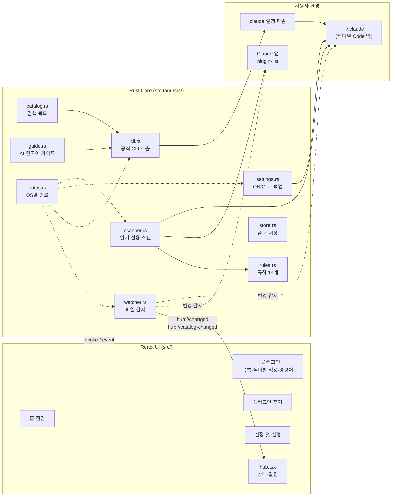

# Plugin Hub

Claude Code와 Claude 앱의 플러그인을 한곳에서 찾고, 설치하고, 정리하고, 켜고 끄는 데스크톱 앱입니다. macOS와 Windows를 지원합니다.

**다운로드: [kimmj1234.github.io/plugin-hub](https://kimmj1234.github.io/plugin-hub/)**

[](https://github.com/kimmj1234/plugin-hub/releases/latest)
[](https://github.com/kimmj1234/plugin-hub/actions/workflows/ci.yml)
[](LICENSE)

Plugin Hub는 Anthropic과 관계없는 개인 오픈소스 프로젝트입니다. Claude와 Claude Code는 Anthropic의 상표입니다.

## 목차

1. [다운로드와 설치](#1-다운로드와-설치)
2. [왜 만들었나](#2-왜-만들었나)
3. [주요 기능](#3-주요-기능)
4. [처음 실행할 때 (권한과 동의)](#4-처음-실행할-때-권한과-동의)
5. [개인정보와 보안](#5-개인정보와-보안)
6. [업데이트](#6-업데이트)
7. [기술 스택과 설계](#7-기술-스택과-설계)
8. [아키텍처](#8-아키텍처)
9. [AI와 나의 역할 구분](#9-ai와-나의-역할-구분)
10. [어려웠던 점과 해결 과정](#10-어려웠던-점과-해결-과정)
11. [한계와 앞으로의 계획](#11-한계와-앞으로의-계획)
12. [소스에서 빌드하기](#12-소스에서-빌드하기)
13. [라이선스](#13-라이선스)

## 1. 다운로드와 설치

[다운로드 페이지](https://kimmj1234.github.io/plugin-hub/)에서 받거나, [최신 릴리스 페이지](https://github.com/kimmj1234/plugin-hub/releases/latest)에서 운영체제에 맞는 파일을 받습니다. 다운로드 페이지는 접속한 운영체제를 알아보고 맞는 파일을 먼저 보여 주며, 항상 최신 릴리스로 연결됩니다(소스: `docs/`).

| 운영체제 | 파일 | 요구 사항 |
|---|---|---|
| macOS (Apple Silicon, Intel 공용) | `Plugin.Hub_<버전>_universal.dmg` | macOS 11 이상 |
| Windows | `Plugin.Hub_<버전>_x64-setup.exe` | Windows 10 이상 (64비트) |

함께 필요한 것: Claude 앱 또는 터미널용 Claude Code 중 하나. Claude 앱에는 Claude Code가 들어 있어 따로 설치하지 않아도 됩니다.

### 처음 열 때 보안 경고가 뜨는 이유

이 앱은 아직 유료 코드 서명 인증서(Apple Developer ID, Windows 코드 서명)로 서명되어 있지 않습니다. 그래서 운영체제가 처음 한 번 경고를 띄웁니다. 앱은 GitHub Actions에서 이 저장소의 공개 코드로 빌드되며, 앱 업데이트 파일은 별도의 개발자 서명으로 검증합니다.

**macOS**

1. dmg를 열고 Plugin Hub를 응용 프로그램 폴더로 끌어 옵니다.
2. Plugin Hub를 엽니다. "Apple이 악성 코드가 없음을 확인할 수 없습니다" 창이 뜨면 **완료**를 누릅니다.
3. 시스템 설정 > 개인정보 보호 및 보안으로 가서 아래쪽의 **그래도 열기**를 누르고 암호를 입력합니다.
4. 이후에는 경고 없이 열립니다.

**Windows**

1. 설치 파일을 실행합니다. "Windows의 PC 보호" 창이 뜨면 **추가 정보**를 누른 뒤 **실행**을 누릅니다.
2. 설치는 현재 사용자 폴더에 되며 관리자 권한이 필요 없습니다.

### 지우기

- macOS: 응용 프로그램 폴더에서 Plugin Hub를 휴지통으로 옮깁니다.
- Windows: 설정 > 앱에서 Plugin Hub를 제거합니다.
- 앱이 만든 정보까지 지우려면 [개인정보 처리방침](PRIVACY.md)의 "정보 삭제"를 따릅니다. Claude Code와 Claude 앱의 설정은 그대로 남습니다.

## 2. 왜 만들었나

Claude Code 플러그인은 공식 디렉터리에만 3,700개가 넘고 계속 늘고 있습니다. 쓰다 보면 이런 문제가 생깁니다.

- 어떤 플러그인이 있는지, 무엇에 쓰는지 찾고 비교하기 어렵다.
- 설치한 플러그인이 쌓여 무엇이 켜져 있는지 파악이 안 된다.
- 켜진 플러그인이 많으면 매 세션 컨텍스트 비용이 늘고, 이름이 겹치는 스킬이 엉뚱하게 불린다.
- 터미널, Claude 앱의 Code 탭, Claude 앱의 채팅이 각각 어떤 플러그인을 쓰는지 구분하기 어렵다.

대상 사용자는 플러그인이 많아져 관리가 부담스러운 Claude Code 사용자와, 설정 파일을 직접 고치기 어려운 입문자입니다.

## 3. 주요 기능

### 플러그인이 쓰이는 곳을 둘로 나눠 보여 줍니다

| 구분 | 포함되는 곳 | 저장 위치 |
|---|---|---|
| Claude Code | 터미널의 Claude Code, Claude 앱의 Code 탭 | 이 PC의 `~/.claude` (둘이 같은 폴더를 씀) |
| Claude 채팅 | Claude 앱의 채팅과 Cowork | Claude 계정 (기기 사이 동기화) |

같은 이름의 플러그인이라도 두 곳에 따로 설치됩니다. 화면의 모든 탭과 표시가 이 기준을 따릅니다.

### 화면 구성

- **홈**: 켜진 플러그인이 매 세션 차지하는 컨텍스트(토큰) 추정, 안 쓰는 플러그인 끄기 추천, 설정 점검 결과
- **내 플러그인**: 목록(켜고 끄기, 폴더로 정리, 상세), 폴더별 적용, 명령어 모음
- **플러그인 찾기**: 공식 디렉터리와 등록한 마켓플레이스 검색, 분야별 인기 플러그인, 설치
- **설정**: 권한과 준비 상태, 개인정보, 앱 업데이트, 기본 설치 범위, 자동 실행

### 기능 목록

| 기능 | 설명 |
|---|---|
| 설치된 플러그인 보기 | 버전, 출처, 설치 범위, 스킬·명령·에이전트·훅·MCP 구성, 한국어 요약 |
| 켜고 끄기 | 설정 파일에 바로 반영. 다른 설정은 보존하고 수정 전에 백업 |
| 적용 범위 | PC 전체 기본값과 작업 폴더별(팀 공유, 나만) 적용을 따로 설정하고 실제 적용 결과를 표시 |
| 검색과 설치 | 공식 Claude Code로 설치·삭제·업데이트. 설치 범위(PC 전체, 폴더) 선택. "디렉터리 새 소식"으로 공식 디렉터리에 최근 7일 안에 새로 올라왔거나 새 버전이 나온 플러그인 보기 |
| Claude 채팅 플러그인 자동 설치 | macOS: Claude 앱 디렉터리에서 검색과 "추가"까지 자동 진행(손쉬운 사용 권한 필요). Windows: 디렉터리를 열고 단계별로 안내 |
| 명령어 모음 | 플러그인을 고르면 그 플러그인의 슬래시 명령과 입력 형식을 보여 줌. "한국어로 보기"로 명령별 한국어 설명과 예시를 만들어 저장. "바로 입력"으로 Claude 앱 채팅 입력창에 명령을 넣음(보내기는 사용자가) |
| 컨텍스트 비용 | 플러그인마다 매 세션 들어가는 토큰을 추정(공식 `claude plugin details` 값과 비교해 맞춘 근사식) |
| 사용 분석 (선택) | 동의한 경우에만 최근 30일 대화 기록에서 플러그인 호출 횟수를 세어 안 쓰는 플러그인을 알려 줌. 설치 7일 안의 플러그인은 추천에서 제외 |
| 설정 점검 | 설정 찌꺼기, 사라진 설치 폴더, 이름 충돌, 너무 많이 켜진 플러그인 등 15개 규칙. 일부는 한 번에 수정. 폴더 범위로 설치한 뒤 그 폴더가 삭제된 플러그인은 설치 기록을 정리 |
| 실시간 반영 | 설정 파일이 바뀌면 바로 다시 검사. 설치 도중의 일시적인 불일치는 오류로 띄우지 않음 |
| 플러그인 자동 업데이트 (선택) | 새 버전이 보이면 자동으로 업데이트 |
| 백그라운드 실행 | 로그인 시 자동 실행(선택), 창을 닫아도 계속 실행, 트레이(메뉴 막대) 아이콘에서 열기와 종료, 중복 실행 방지 |
| 앱 자체 업데이트 | GitHub Releases에서 서명된 업데이트를 받아 설치. 자동, 알림만, 끄기 중 선택 |

## 4. 처음 실행할 때 (권한과 동의)

처음 실행하면 기능을 쓰기 전에 설정 화면이 나옵니다.

1. **개인정보 안내와 동의**: 앱이 무엇을 읽고, 어디에 저장하고, 언제 인터넷에 연결하는지 보여 주고 동의를 받습니다(필수). 사용 분석은 여기서 따로 고릅니다(선택, 기본 꺼짐).
2. **권한과 준비 상태**: 필요한 것을 한 화면에서 점검합니다. 운영체제가 앱 스스로 켜지 못하게 막아 둔 권한은 버튼으로 요청하고, 사용자가 켜면 화면이 자동으로 "준비됨"으로 바뀝니다. 켜지 않은 권한이 필요한 기능만 잠기고 나머지는 쓸 수 있습니다.

| 항목 | 필요한 기능 | 설정 방법 |
|---|---|---|
| Claude Code | 설치, 삭제, 업데이트 | Claude 앱 또는 터미널용 Claude Code 설치 (앱이 자동으로 찾음) |
| 손쉬운 사용 권한 (macOS) | Claude 채팅 플러그인 자동 설치 | "권한 요청"을 누른 뒤 시스템 설정에서 Plugin Hub를 켬 |
| Claude 계정 로그인 | 명령어 한국어 설명(AI) | "로그인"을 누르면 공식 로그인 명령이 열림 |
| Claude 앱 | Claude 채팅 플러그인 | Claude 앱 설치 |

3. **실행과 업데이트**: 로그인 시 자동 실행, 플러그인 자동 업데이트, 앱 업데이트 방식을 고릅니다.

이 화면은 설정 > 권한과 준비 상태에서 언제든 다시 열 수 있습니다. 개인정보 안내가 바뀌면 다시 동의를 받습니다.

## 5. 개인정보와 보안

- 개발자 서버가 없습니다. 사용 통계, 광고, 추적, 오류 보고를 수집하거나 보내지 않습니다.
- 앱이 읽는 파일, 저장하는 위치, 인터넷에 연결하는 경우는 [개인정보 처리방침](PRIVACY.md)에 모두 적었습니다.
- 외부 플러그인은 신뢰하지 않는 입력으로 다룹니다(크기 제한, 링크 거부, HTML 미렌더링). 명령은 셸을 거치지 않고 실행하며 인자를 검증합니다. 설정 파일은 원자적으로 쓰고 권한을 유지하며 백업합니다. 자세한 내용과 취약점 신고 방법은 [보안 정책](SECURITY.md)에 있습니다.
- 릴리스 전 점검: 독립 보안 검토와 claude-security 스캔(여러 에이전트 교차 검증)을 거쳐 찾은 문제를 모두 고쳤습니다. CI에서 테스트와 의존성 취약점 검사를 실행합니다.
- 포함된 오픈소스 목록은 [THIRD_PARTY_NOTICES.md](THIRD_PARTY_NOTICES.md), 라이선스 전문은 [THIRD_PARTY_LICENSES.txt](THIRD_PARTY_LICENSES.txt)에 있고 앱 설치 파일에도 들어 있습니다(설정 > 정보 > 오픈소스 라이선스). GPL 계열 구성 요소는 없습니다.

## 6. 업데이트

- 앱은 GitHub Releases의 업데이트 정보를 확인하고, 개발자 서명 키로 서명된 파일만 설치합니다. 서명이 맞지 않으면 설치하지 않습니다.
- 다시 내려받거나 설치 프로그램을 실행할 필요가 없습니다. 설정 > 앱 업데이트에서 방식을 고릅니다.
  - 자동으로 받아 설치(기본): 시작 후와 6시간마다 확인해 내려받아 설치하고, 다시 시작하면 적용됩니다.
  - 알림만: 새 버전이 있으면 사이드바와 설정에 표시하고, 누르면 설치합니다.
  - 확인하지 않음: "지금 확인"을 누를 때만 찾습니다.
- 개발자는 버전을 올리고 `v<버전>` 태그를 푸시하면 GitHub Actions가 macOS와 Windows 설치 파일, 업데이트 파일을 만들어 릴리스에 올립니다. 절차는 [RELEASING.md](RELEASING.md)에 있습니다.

## 7. 기술 스택과 설계

| 영역 | 선택 | 이유 |
|------|------|------|
| 앱 셸 | **Tauri 2** | 설치 파일이 가볍고 메모리를 적게 쓴다. 상시 켜 두는 관리 도구에 맞다. macOS와 Windows를 같은 코드로 빌드할 수 있다. |
| UI | **React 19 + TypeScript** | 목록·토글·상세 화면처럼 상태가 많은 UI에 적합하다. |
| 시스템 로직 | **Rust** | 설정 파일 읽기·쓰기, 파일 감시(`notify`), CLI 실행을 OS별로 분리하기 좋다. |
| 설치 엔진 | **공식 `claude plugin` CLI** | 설치·삭제·업데이트를 직접 구현하지 않았다. 캐시와 마켓플레이스 처리는 공식 도구가 가장 정확하고, Claude Code가 바뀌어도 따라가기 쉽다. |

**검토 후 선택하지 않은 대안**

- **Electron**: 자료가 많지만 앱 용량과 메모리가 크다. 상시 실행 도구에는 부담이라 제외했다.
- **Swift (macOS 네이티브)**: Windows 확장 때 처음부터 다시 만들어야 해서 제외했다.
- **설치 로직 직접 구현** (git clone 후 파일 복사): 처음에는 고려했지만, CLI에 `--json` 출력이 있어 그대로 쓰는 편이 안전하다고 판단했다.

**주요 설계 결정**

- **ON/OFF는 CLI를 거치지 않고 `settings.json`을 직접 수정한다.** CLI는 실행마다 약 0.5~0.7초가 걸린다(측정값). 폴더 단위로 여러 개를 켜고 끄면 몇 초씩 기다려야 한다. 직접 수정해 보니 CLI와 같은 `enabledPlugins` 키를 쓰는 것을 확인했다. 다른 키와 순서는 보존하고, 수정 전에 백업을 20개까지 남긴다. user 범위가 아닌 플러그인만 CLI로 처리한다.
- **폴더별 켜기/끄기도 설정 파일을 직접 고친다.** 공식 CLI는 "설치된 범위와 다른 범위"에서 켜고 끄는 것을 거부한다(실험으로 확인). 그래서 PC 전체에 설치된 플러그인을 특정 폴더에서만 끄는 일은 CLI로 할 수 없다. 대신 Claude Code의 설정 우선순위를 그대로 이용해 폴더의 `.claude/settings(.local).json`에 값을 쓴다. 쓸 수 있는 폴더는 사용자가 등록한 폴더와 설치 기록에 남은 폴더로 제한해, 화면에서 임의 경로에 파일을 쓰지 못하게 했다.
- **Claude 앱 플러그인은 읽기 전용이다.** 앱이 서버의 계정 설정과 동기화하므로, 로컬 파일을 바꿔도 앱이 되돌릴 수 있다.
- **README는 HTML로 넣지 않는다.** 외부 플러그인의 README에 스크립트가 섞여 있으면 앱 권한으로 실행될 수 있어서, 마크다운을 React 요소로 직접 변환했다.
- **CLI 인자는 검증한다.** 플러그인 id는 허용된 문자만 받는다. `-`로 시작하는 값도 막아 인자 주입을 차단했다.


### 7-1. 조사로 알아낸 플러그인 저장 구조

| 구분 | 위치 (macOS) | 내용 |
|------|------|------|
| 터미널·Claude Code | `~/.claude/settings.json` | `enabledPlugins` (켜짐 여부), `extraKnownMarketplaces` |
| | `~/.claude/plugins/installed_plugins.json` | 설치 기록 (버전, 범위, 설치 경로) |
| | `~/.claude/plugins/known_marketplaces.json` | 등록된 마켓플레이스 |
| | `~/.claude/plugins/plugin-directory-cache-v2.json` | 내장 공식 디렉터리(`anthropic-plugin-directory`)의 플러그인 목록과 최신 버전. 이 마켓플레이스는 위 파일에 기록되지 않음 |
| 폴더(프로젝트)별 | `<폴더>/.claude/settings.json` / `settings.local.json` | 그 폴더에서만 적용되는 `enabledPlugins` (팀 공유 / 나만). 폴더 설정이 PC 전체 설정보다 우선 |
| | `~/.claude.json`의 `projects` | Claude Code로 작업했던 폴더 목록 (폴더 추천에 사용) |
| | `~/.claude/plugins/cache/<마켓>/<이름>/<버전>/` | 플러그인 본체 (`.claude-plugin/plugin.json`, `skills/`, `hooks/` 등) |
| Claude 앱 (채팅·Cowork) | `~/Library/Application Support/Claude/plugin-list/…/plugins.json` | 계정에 동기화된 플러그인과 켜짐 여부 |
| Claude 앱 내장 CLI | `~/Library/Application Support/Claude/claude-code/<버전>/` | 앱의 Code 탭이 쓰는 Claude Code. 설정은 터미널과 같은 `~/.claude`를 사용 |

터미널용 CLI가 없어도 앱 내장 CLI가 있으면 그것으로 설치 명령을 실행합니다.

## 8. 아키텍처



**데이터 흐름**
1. `scanner`가 두 환경의 설정 파일을 읽어 플러그인 목록을 만들고, `rules`가 진단을 붙여 화면에 보낸다.
2. 토글은 `settings`가 `settings.json`을 직접 고친다. 설치·삭제·업데이트는 `cli`가 공식 CLI를 실행한다.
3. 어떤 경로로 파일이 바뀌든(이 앱, 터미널 명령, 직접 편집) `watcher`가 감지한다. 그러면 화면이 다시 스캔하고, 새 경고가 생기면 알림을 띄운다.
4. 폴더 구성, 카탈로그에서 본 기록(`catalog-seen.json`), AI 가이드(`guides/`)는 Claude 설정과 섞이지 않도록 앱 데이터 폴더에 따로 저장한다.
5. 분류와 인기도는 프론트엔드(`src/catalogMeta.ts`)가 계산한다. 인기도는 수집해 둔 GitHub 스타 스냅샷(`src/data/popularity.json`)을, 한국어 요약은 `src/data/ko-catalog.json`을 쓴다.

## 9. AI와 나의 역할 구분

이 프로젝트는 AI 코딩 도구(Claude Code)와 함께 만듭니다.

**내가 한 것**
- 문제 정의: 무분별하게 늘어나는 플러그인 관리, 앱/터미널 구분, 잘못된 사용 감지
- 범위 결정: macOS 먼저, 이후 Windows까지 배포
- 기술 선택: Tauri + React
- 진행 방식 결정과 결과 확인: 저장소 공개 범위, 인증 방식, 실행 결과 확인

**AI에게 맡긴 것**
- 플러그인 저장 구조 조사 (설정 파일 위치, CLI 명령 확인)
- Rust 코어와 React UI 구현, 테스트 작성
- 문서 초안 (README, DEVLOG)

**AI의 제안을 거절하거나 뒤집은 사례**

자세한 날짜별 기록은 [DEVLOG.md](DEVLOG.md)에 있습니다.

| 날짜 | AI의 제안 | 내 판단 | 이유 | 결과 |
|------|-----------|---------|------|------|
| 2026-11-20 | 커밋은 터미널 git, 푸시는 GitHub Desktop 화면에서 하자고 제안 | 거절. 브라우저에 이미 로그인된 상태로 gh 웹 인증을 진행하도록 지시 | GUI 앱은 AI가 조작할 수 없고 설정이 둘로 나뉘어 번거롭다고 판단 | gh 인증 후 한 번에 푸시 완료 |
| 2026-11-21 | Claude 앱 플러그인은 웹(claude.ai)에서 추가하고 앱에 반영하는 3단계로 안내 | 거절. 웹이 열리지 않고 Claude 앱 안에서 다운로드까지 끝나게 하라고 지시 | 앱 사용자에게 브라우저를 오가는 흐름은 불편하다고 판단 | Claude 앱 코드에서 앱 내부 주소를 찾아 앱 화면에서 바로 추가하는 방식으로 변경 |
| 2026-11-21 | 마지막 "추가" 클릭은 보안상 사용자가 직접 누르게 하자고 제안 | 거절. 설치까지 완전 자동으로 되게 하라고 지시 | 사용자가 "설치"를 누른 것 자체가 동의이고, 앱을 오가는 클릭은 불편하다고 판단 | 로그인 토큰을 쓰지 않고, macOS 손쉬운 사용 권한(사용자가 직접 허용)으로 Claude 앱 화면의 버튼을 대신 누르는 방식으로 완전 자동 설치를 구현 |
| 2026-11-21 | 설치된 모든 플러그인의 슬래시 명령을 한 화면에 모아 보여 줌 | 변경. 플러그인을 먼저 고르고 그 플러그인의 명령만 한국어로 보이게, "바로 입력"으로 Claude 채팅에 넣게 하라고 지시 | 전부 모아 두면 내가 쓰고 싶은 플러그인을 찾기 어렵고 영어 설명은 이해하기 어렵다고 판단 | 플러그인별 명령어 화면, AI 한국어 설명, Claude 앱 채팅 바로 입력 구현 |
| 2026-11-21 | claude-security 플러그인이 이 세션에 없으니 기본 보안 검토로 대신하겠다고 안내 | 거절. 문제를 정확히 확인하고 해결될 때까지 반복 테스트하라고 지시 | 요청한 도구를 쓰지 못한 이유가 불분명했고, 설치 직후 오류 알림도 함께 해결해야 한다고 판단 | 플러그인 설치 후 claude-security 스캔(검증 1건 수정) + 독립 검토 8건 수정, 설치 오탐 원인(파일 쓰기 순서) 규명과 수정 |
| 2026-11-21 | 권한은 필요할 때마다 그 자리에서 요청 | 변경. 설치 직후 첫 실행에서 권한과 동의를 한 번에 설정하고, 자동으로 못 켜는 권한은 직접 켜기 전까지 해당 기능을 잠그게 지시 | 쓰다가 갑자기 권한 창이 뜨는 것보다 처음에 한 번 정리하는 편이 사용자에게 명확하다고 판단 | 3단계 첫 실행 설정(개인정보 동의, 권한 점검과 실시간 확인, 실행·업데이트 방식) 구현 |
| 2026-11-22 | 디자인 검토 결과(용어, 토큰 표시, 범위 설정 등)를 놓고 방향을 먼저 묻고 진행 | 변경. Windows까지 확인하고 승인 절차 없이 바로 배포해 기존 사용자에게 적용하라고 지시 | 사용자가 겪는 문제를 빨리 고치는 것이 우선이라고 판단 | 확인된 버그·접근성 문제만 고쳐 v1.0.3으로 배포하고, 방향이 필요한 디자인 변경은 남김 |

## 10. 어려웠던 점과 해결 과정

### Claude 앱과 터미널은 플러그인을 어디서 구분하는가
- 문제: "앱 버전과 터미널 버전을 나눠 관리"하려면, 두 환경이 플러그인을 따로 저장하는지 먼저 알아야 했다.
- 원인: 공개 문서만으로는 앱 쪽 저장 위치를 알 수 없었다.
- 시도: 처음에는 앱과 터미널이 완전히 다른 설정을 쓴다고 가정했다. 그런데 실제 파일을 조사해 보니, 앱의 Code 탭은 내장 CLI로 터미널과 **같은** `~/.claude`를 쓰고 있었다. 앱의 채팅·Cowork 플러그인만 계정 동기화 파일(`plugin-list/…/plugins.json`)에 따로 있었다.
- 결과: 구분 기준을 "실행 프로그램"이 아니라 "설정 저장소"로 바꿨다. 앱 동기화 플러그인은 읽기 전용으로 다룬다.
- 배운 점: 가정으로 설계하지 말고, 실제 데이터를 먼저 확인해야 한다.

### macOS GUI 앱에서 `claude` 명령을 찾지 못함
- 문제: 터미널에서는 되는 CLI 호출이, 앱에서 실행하면 "명령을 찾을 수 없음"이 될 수 있었다.
- 원인: Finder에서 실행한 macOS 앱은 셸의 PATH(`~/.zshrc`)를 물려받지 않는다. 게다가 이 개발 환경에는 터미널용 CLI가 아예 없었다.
- 시도: PATH만 검색하는 방식은 실패한다. 흔한 설치 위치(`~/.local/bin`, Homebrew 등)를 직접 더했고, 그래도 없으면 Claude 앱 내장 CLI를 버전순으로 찾아 쓰게 했다. 자식 프로세스에는 git 등을 찾을 수 있게 PATH를 보강해서 넘긴다.
- 결과: 터미널 CLI가 없는 환경에서도 앱 내장 CLI(2.1.325)로 카탈로그 3,778개를 불러왔다.
- 배운 점: GUI 앱의 실행 환경은 터미널과 다르다.

### 파일 감시 이벤트가 한 번에 여러 번 옴
- 문제: 설정 파일 하나를 저장해도 이벤트가 여러 번 와서, 화면이 연달아 다시 스캔될 수 있었다.
- 원인: 원자적 저장(임시 파일 → 이름 변경)과 OS 파일 이벤트 특성 때문이다. 같은 폴더의 큰 캐시 파일(2.8MB)도 자주 바뀐다.
- 시도: 감시 대상 파일 이름을 5개로 한정했다. 350ms 안에 몰린 이벤트는 한 번으로 합쳤다.
- 결과: 변경 한 번에 갱신 한 번. 실제 파일을 건드려 로그로 확인했다.

### 카탈로그에 "인기도"와 "분류"가 없음
- 문제: "분야별 인기 TOP 5"를 보여 줘야 하는데, 공식 CLI 카탈로그(3,778개)에는 설치 수도 분류도 없었다.
- 원인: CLI가 주는 정보는 이름, 설명, 버전, 소스 주소뿐이다.
- 시도: 설치 수를 얻을 공개 API를 찾았지만 없었다. 그래서 공개적으로 확인할 수 있는 소스 저장소의 GitHub 스타 수를 인기 지표로 삼았다. 저장소 3,393개를 GraphQL로 100개씩 묶어 34번 조회해 3,370개를 받았다. 분류는 이름·설명 키워드로 나눴다.
- 결과: 한 저장소에 플러그인이 수십 개 있으면 모두 같은 스타 수를 갖는 문제가 있다. TOP 5는 저장소당 최대 2개까지만 뽑아 한쪽으로 쏠리지 않게 했다. 화면에 "GitHub 스타 기준 (수집일)"을 밝혔다.
- 배운 점: 원하는 지표가 없을 때는 대체 지표를 쓰되, 그 한계를 화면에 솔직하게 표시해야 한다.

### 한국어 설명을 어떻게 제공할까
- 문제: 3,700여 개 플러그인 설명이 대부분 영어다.
- 시도: 앱 안에서 Claude로 번역하려 했지만, Claude 앱 내장 CLI는 단독 실행 시 로그인되어 있지 않았다(`Not logged in`).
- 결과: 두 층으로 나눴다. 공식 플러그인 119개는 한국어 요약을 미리 번역해 내장했다. 나머지는 사용자가 원할 때 로그인된 Claude Code로 가이드를 만들어 저장한다. 가이드를 만들 때는 빈 폴더에서 `--setting-sources project --tools ""`로 실행한다. 이렇게 해서 사용자의 다른 플러그인 훅이 실행되거나 도구가 쓰이지 않게 했다.

### 공식 디렉터리 플러그인을 "등록되지 않은 마켓플레이스"로 오진
- 문제: 공식 디렉터리에서 플러그인을 설치하자 진단에 "마켓플레이스 'anthropic-plugin-directory'가 등록되어 있지 않습니다" 경고가 떴다(사용자 제보).
- 원인: 이 마켓플레이스는 Claude Code에 내장되어 있어 `known_marketplaces.json`이 아니라 `plugin-directory-cache-v2.json`으로 관리된다.
- 결과: 디렉터리 캐시가 있으면 등록된 것으로 보고, 캐시의 버전으로 업데이트도 확인한다. 설치 버전 뒤에 붙는 커밋 해시(`1.1.1-73c8cf3`)는 비교에서 뺀다.

### Claude 앱 플러그인을 이 앱에서 설치할 수 있을까
- 문제: 앱 플러그인도 이 프로그램에서 설치하고 싶었다.
- 원인: 앱 플러그인은 계정(서버)에 연결되어 관리된다. 로컬 `plugins.json`은 동기화 결과일 뿐이라, 직접 고치면 앱이 되돌리고, 서버에 직접 요청하려면 사용자의 로그인 토큰을 써야 한다. 둘 다 안전하지 않다.
- 시도: Claude 앱이 등록한 `claude://` 링크를 조사했다. 플러그인 화면(`claude://claude.ai/customize/plugins/id/<앱 설치 ID>`)과 요청이 채워진 새 채팅(`claude://claude.ai/new?q=…`)을 열 수 있었다. 공식 목록 캐시에는 플러그인마다 서버 ID와 지원 대상(`claude_code`, `cowork`, `claude_ai`)이 있었다.
- 실패: 처음에는 공식 목록 캐시의 ID(`plugin_013nz…`)로 플러그인 화면을 열었는데, Claude 앱에 "이 항목을 사용할 수 없습니다"가 떴다(사용자 확인). Claude 앱은 계정에 설치할 때 따로 ID(`plugin_012dA…`)를 붙이고, 이 ID는 앱 설치 폴더 이름에 남는다. 설치 전에는 이 ID를 알 수 없다.
- 결과: 설치 전 플러그인은 Claude 앱의 플러그인 화면을 열고 이름을 복사해 검색에 붙여 넣게 했다. 공식 디렉터리 플러그인은 Claude 앱 안에서 이름이 UUID라 설치 전에는 바로 가는 주소를 만들 수 없다. 화면이 Claude 앱으로 넘어가면 알림을 놓치기 쉬워서, 이 앱에 설치 안내 카드를 남기고 설치가 감지되면 "설치 완료"로 바꾼다. 이미 설치된 앱 플러그인은 설치 폴더 이름의 ID로 그 플러그인 화면을 바로 연다. 설치되면 파일 감시로 바로 알린다. 링크는 Rust에서만 만들고 ID 문자와 요청 길이를 검사한다.
- 다시 실패와 해결: 목록 화면 + 이름 복사도 사용자가 직접 찾아야 해서 불편했다. Chrome으로 claude.ai를 직접 조사해 (1) 플러그인 화면 주소는 `/plugins/id/<UUID>@anthropic-plugin-directory`이고 이 UUID는 PC 어디에도 없으며, (2) `/customize/plugins?q=이름`은 검색 결과를 바로 보여주고, (3) 웹에서 추가한 플러그인은 Claude 앱의 플러그인 화면을 여는 순간 PC의 `plugins.json`에 동기화된다는 것을 확인했다. 그래서 웹 검색 결과 → 추가 → "Claude 앱에 반영" 3단계로 바꿨고, 실제 계정으로 끝까지 확인했다.
- 세 번째 변경 (사용자 지시): 사용자가 "웹이 열리지 말고 Claude 앱 안에서 다 되게" 해 달라고 했다. Claude 앱 내부 코드에서 `claude://` 주소 처리기를 읽어 보니, 플러그인 화면 주소는 검색어(`?q=`)를 지우지만 `customize/plugins/new?marketplace=…&plugin=…`는 앱 안의 "마켓플레이스 추가" 창을 값이 채워진 채로 연다. 그래서 공식 디렉터리 플러그인은 열리자마자 검색창이 활성화되는 Claude 앱의 디렉터리(`claude://claude.ai/directory`)를 열고 이름을 복사해 두고, GitHub 마켓플레이스 플러그인은 채워진 추가 창을 연다. 브라우저는 열지 않는다. Claude 앱 화면이 열려 있으면 앱이 계정과 바로 동기화되므로 "반영" 단계도 필요 없어졌다.
- 네 번째 변경 (사용자 지시): 사용자는 클릭 없이 설치까지 완전 자동으로 되기를 원했다. 로그인 토큰을 꺼내 서버에 직접 요청하는 방법은 다른 앱의 인증 정보를 쓰는 것이라 택하지 않았다. 대신 macOS 손쉬운 사용 API로 Claude 앱 화면을 읽어 보니 디렉터리의 검색창, 결과의 "○○ 보기" 링크, 상세 화면의 "추가" 버튼이 모두 이름으로 잡혔다. Plugin Hub가 사용자가 고른 플러그인만 찾아 이 버튼들을 대신 누르게 했다. 결과 항목의 저장소 이름(예: `obra/superpowers`)으로 같은 이름의 다른 플러그인과 구분한다. 처음에는 추가 후 "추가됨"이 버튼이 아니라 글자로 바뀌는 것을 몰라 완료 판정이 실패했는데, 실제 화면 구조를 다시 읽고 고쳤다. 권한은 사용자가 macOS 설정에서 직접 허용한다.
- 배운 점: "자동화하면 안 된다"고 단정하기 전에 사용자 동의를 받는 안전한 방법(OS 권한)이 있는지 찾아봐야 한다. 인증 정보를 꺼내 쓰는 것과, 사용자가 허용한 권한으로 화면을 대신 누르는 것은 다르다.

### 설치한 플러그인이 '플러그인 찾기'에서 사라짐
- 문제: 실제 CLI로 돌린 통합 테스트에서, 설치한 플러그인이 카탈로그 목록에 없었다.
- 원인: `claude plugin list --available --json`은 설치된 플러그인을 `available`이 아니라 `installed`에 따로 담아 준다.
- 결과: 두 목록을 합치고, 설치된 항목의 이름·설명은 설치 폴더의 plugin.json에서 읽게 했다.
- 배운 점: 외부 도구의 출력 형식은 문서나 추측 대신 실제 출력으로 확인해야 한다.

### 파일을 쓰는 중에 읽으면 오진이 생김
- 문제: 코드 검토에서, 설치 기록 파일을 읽지 못하면 켜진 플러그인 전부가 "설치되지 않음" 오류로 뜨고 "설정에서 항목 제거" 버튼이 나오는 것을 찾았다. 파일 감시 때문에 Claude Code가 파일을 쓰는 도중에 스캔할 수 있어 실제로 생길 수 있는 상황이다.
- 결과: 읽기 실패를 별도 진단으로 알리고, 그동안 "설치되지 않음" 검사는 건너뛴다. 설정 쓰기에는 잠금과 고유 임시 파일을 써서 동시 저장으로 변경이 사라지지 않게 했다.

### 플러그인을 설치하면 "켜져 있지만 설치되지 않음" 빨간 경고가 잠깐 뜸
- 문제: 플러그인을 설치할 때마다 빨간 오류 알림이 떴다가 사라졌다.
- 원인: 격리된 폴더에서 공식 CLI 설치를 5ms 간격으로 지켜보니, CLI가 `settings.json`(켜짐)을 먼저 쓰고 설치 기록(`installed_plugins.json`)은 약 2.8초 뒤에 썼다. Plugin Hub는 첫 파일이 바뀌는 순간 검사해 그 사이를 오류로 판단했다.
- 해결: 최근 30초 안에 바뀐 설정에서 생긴 불일치는 "설치 마무리 중"(안내)으로 보여 주고 5초마다 다시 확인한다. 새 오류·경고 알림은 3초 뒤 다시 검사해서도 남아 있을 때만 띄운다.
- 검증: 실제 공식 CLI로 7개 플러그인을 격리 설치하며 50ms마다 검사하는 테스트에서, 과거 오류로 보였을 순간이 매번 15~19회 있었고 빨간 오류는 0회였다.

### 보안 점검 (독립 검토 + claude-security 스캔)
- 독립 검토에서 중간 2건, 낮음 6건을 찾아 모두 고쳤다: 외부 플러그인 파일 크기 제한·심볼릭 링크 거부(README 링크로 ~/.ssh 키가 화면·AI 프롬프트로 새는 것 방지), 설정 저장 시 권한 유지(0600 → 0644로 넓어지던 문제), 프로젝트 `.claude` 링크로 다른 설정 파일을 덮어쓰는 것 차단, 작업 폴더로 시스템·민감 폴더 등록 차단, README 주석 정규식 DoS 제거(200KB 악성 README 3.4초 → 1ms), Claude 앱 자동 설치가 이름 근처의 "추가" 버튼 하나만 누르도록 강화, AI 가이드 프롬프트 길이 제한, AI가 만든 예시 입력 검증.
- 이어서 claude-security 플러그인 스캔(보통 깊이, 에이전트 32개, 3인 교차 검증)을 돌렸다. 검증을 통과한 것은 1건(낮음): 모델 응답의 괄호 순서가 뒤집히면 문자열 자르기에서 패닉이 나고, 릴리스 빌드는 `panic = "abort"`라 앱 전체가 꺼지는 문제. 경계 검사로 고치고 공격 입력 테스트를 추가했다. 프롬프트 주입 후보는 3:0으로 기각되었다(작성자가 이미 통제하는 글 이상을 얻지 못하고, 가이드 실행은 도구가 모두 꺼져 있음).

### Claude 앱 화면이 바뀌어 자동 설치가 "찾지 못함"으로 실패
- 문제: 지난번에 되던 자동 설치가 이미 추가된 플러그인에서 실패했다.
- 원인: Claude 앱 디렉터리가 바뀌어, 계정에 있는 플러그인은 "계정에 추가됨" 구역에 링크가 아닌 버튼으로 나왔다(손쉬운 사용 트리 덤프로 확인).
- 해결: 버튼도 후보로 보고 "계정에 추가됨" 구역이면 바로 "이미 추가됨" 처리. 실제 계정에서 이미 추가된 3개와 새 플러그인 1개(16→17)로 재확인했다.

### 가짜 데이터에서는 안 보이던 문제 (실제 앱 점검)
- 실제 Plugin Hub 화면을 실제 데이터로 하나씩 눌러 보니 7개 문제가 나왔다. 대표적으로 plugin.json에 스킬 경로를 직접 적는 플러그인(`"skills": "./"`)의 스킬을 못 읽었고, 설치 id와 스킬 이름이 다른 플러그인은 사용 횟수를 못 셌으며, Claude 앱 플러그인은 id가 UUID라 한국어 요약을 못 찾았다. 모두 고치고 실제 화면에서 다시 확인했다.

### 배포한 Mac 앱이 내려받으면 열리지 않을 수 있었음
- 문제: v1.0.0을 공개한 뒤 릴리스 파일을 직접 내려받아 검사하니, CI에서 만든 Mac 앱은 실행 파일만 서명되고 앱 번들 전체는 봉인되지 않았다. 이 상태로 인터넷에서 받으면 Apple Silicon Mac이 "손상되었기 때문에 열 수 없습니다"로 거부하고 "그래도 열기"도 나오지 않는다.
- 원인: 내 Mac의 빌드는 자동으로 봉인되지만, CI의 유니버설 빌드에서는 그 단계가 빠졌다.
- 해결: ad-hoc 서명(`signingIdentity: "-"`)을 명시하고, 릴리스 워크플로에 `codesign --verify --deep --strict` 검사를 넣어 서명이 빠지면 배포 자체가 실패하게 했다(v1.0.1).
- 검증: v1.0.1 릴리스 파일을 내려받아 봉인을 확인했고, 0.9.9로 만든 시험 앱이 실행 70초 안에 GitHub에서 v1.0.1을 받아 서명을 확인하고 스스로 교체한 뒤 "다시 시작"으로 새 버전이 뜨는 것까지 확인했다.

### 폴더를 지우면 그 폴더에 설치한 플러그인을 지울 수 없음
- 문제: Windows 사용자 제보. "폴더·나만" 범위로 설치한 뒤 그 폴더를 지우자 켜기·끄기·업데이트·삭제가 모두 "폴더를 찾을 수 없습니다"로 실패했다.
- 원인: 폴더 범위 설치는 기록에 폴더 경로가 남고, 공식 Claude Code도 그 폴더 안에서 실행해야만 삭제한다. 격리 환경에서 재현해 보니 다른 폴더에서는 "not installed in local scope"로 거부했다. 폴더가 사라지면 공식 방법으로는 기록을 지울 수 없다.
- 해결: "설치한 폴더 없음"을 표시하고 안 되는 동작은 막고 이유를 설명한다. "설치 기록 정리"는 같은 경로에 빈 폴더를 잠깐 만들어 공식 명령으로 지운 뒤, 앱이 만든 폴더만 지운다(그 사이 다른 파일이 생기면 남긴다).
- 검증: 실제 Claude Code를 격리 설정으로 돌리는 통합 테스트로 재현부터 정리까지 확인했다.

### "업데이트" 표시가 내 플러그인 업데이트로 오해됨
- 문제: 설치하지 않은 플러그인에 "최근 업데이트"가 계속 떴다(사용자 제보).
- 원인: 공식 디렉터리 전체에서 최근 7일 안에 버전이 바뀐 플러그인을 같은 단어로 표시했고, 왼쪽 메뉴에도 숫자를 붙였다.
- 해결: "디렉터리 새 소식", "새 버전 출시"로 이름을 바꾸고 메뉴 숫자를 없앴다. 조회 경로에 따라 버전이 비었다 채워지며 다시 "업데이트"로 표시되던 결함도 고쳤다.

### 여러 검토 도구로 전체를 다시 점검 (v1.0.3)
- 문제: 기능이 늘면서 Windows 전용 문제와 오류를 조용히 삼키는 곳이 쌓였을 수 있었다.
- 시도: ecc 플러그인의 검토 에이전트 5개(Rust, React, 보안, 조용한 실패, 테스트 공백)와 디자인 검토(판단과 자동 검출을 따로)를 독립적으로 돌리고, 지적을 하나씩 코드로 확인했다.
- 결과: Windows 경로 형식(`\\?\`), BOM 설정 파일, 파일 잠금 저장 실패, 앱 설정을 못 읽으면 등록 폴더가 지워질 수 있던 문제 등을 고치고 테스트로 고정했다(테스트 15 → 20개). 키보드 조작, 확인 창, 대비 같은 접근성 문제도 고쳤다.
- 배운 점: 검토 결과는 그대로 믿지 않고 코드와 테스트로 확인해야 한다. 실제 환경 검사에서만 보이는 문제도 있다.

## 11. 한계와 앞으로의 계획

**현재 한계**
- 유료 코드 서명이 없어 처음 열 때 운영체제 경고가 뜹니다(1장 참고). macOS는 서명이 없으면 앱이 업데이트될 때 손쉬운 사용 권한을 다시 허용해야 할 수 있습니다(앱이 권한이 꺼진 것을 감지하고 안내합니다). Apple Developer ID와 Windows 코드 서명은 [RELEASING.md](RELEASING.md)의 방법으로 붙일 수 있습니다.
- Claude 채팅 플러그인 자동 설치는 Claude 앱의 화면 구조에 의존합니다. Claude 앱이 바뀌면 깨질 수 있으며, 실패하면 직접 추가하는 안내로 넘어갑니다. Windows는 자동 설치 대신 단계 안내를 합니다.
- 사용 분석은 이 PC의 Claude Code 대화 기록만 봅니다. Claude 앱 채팅 기록은 PC에 없어 셀 수 없습니다. 컨텍스트 비용은 추정값이며 MCP 도구 설명은 포함하지 않습니다.
- 인기도는 2026-11-20에 수집한 GitHub 스타 스냅샷이고, 분류는 키워드 기반입니다.
- 한국어 요약은 공식 플러그인 119개만 내장되어 있습니다. 나머지는 "한국어로 보기"(Claude 로그인 필요)로 만듭니다.
- Claude 채팅 플러그인은 켜고 끌 수 없습니다(계정 동기화라 Claude 앱에서 관리).
- Claude Code의 내부 파일 구조에 의존하므로 Claude Code가 크게 바뀌면 호환성을 확인해야 합니다. 설치처럼 위험한 작업은 공식 CLI에 맡겨 영향을 줄였습니다.
- Windows 설치 파일은 CI(Windows 러너)에서 빌드·테스트를 통과하고, 실제 Windows PC에서 사용하며 나온 문제(AI 가이드 실행, 폴더 범위 설치, 업데이트 표시)를 고쳐 왔습니다. 개발은 Mac에서 하므로 Windows 화면은 사용 중 제보와 CI에 의존합니다.
- 같은 플러그인을 여러 범위(PC 전체와 특정 폴더 등)에 함께 설치하면 목록에는 하나만 보입니다.
- 노치가 있는 MacBook에서 메뉴 막대 아이콘이 많으면 macOS가 자리가 없는 아이콘을 숨기므로 Plugin Hub 트레이 아이콘이 보이지 않을 수 있습니다. 이때는 Dock 아이콘으로 열고 ⌘Q로 종료합니다.
- 회사가 관리하는 정책 설정(managed settings)은 고려하지 않았습니다.

**앞으로의 계획**
- 코드 서명과 공증
- 인기도 스냅샷 자동 갱신
- 영어 화면
- 스크린샷과 시연 영상

## 12. 소스에서 빌드하기

필요한 도구: Node.js 20 이상, Rust(stable), macOS는 Xcode Command Line Tools, Windows는 Microsoft C++ Build Tools와 WebView2.

```bash
git clone https://github.com/kimmj1234/plugin-hub.git
```

```bash
cd plugin-hub && npm ci
```

```bash
npm run tauri dev
```

배포용 빌드(`src-tauri/target/release/bundle/`에 생성):

```bash
npm run tauri build
```

테스트(실제 `~/.claude`가 아닌 임시 폴더에서 검증):

```bash
cd src-tauri && cargo test
```

가짜 데이터로 화면만 확인(브라우저에서 http://localhost:1420):

```bash
npm run dev
```

## 13. 라이선스

[MIT](LICENSE). 포함된 오픈소스의 라이선스는 [THIRD_PARTY_NOTICES.md](THIRD_PARTY_NOTICES.md)를 참고하세요. 개발 과정 기록은 [DEVLOG.md](DEVLOG.md)에 있습니다.
